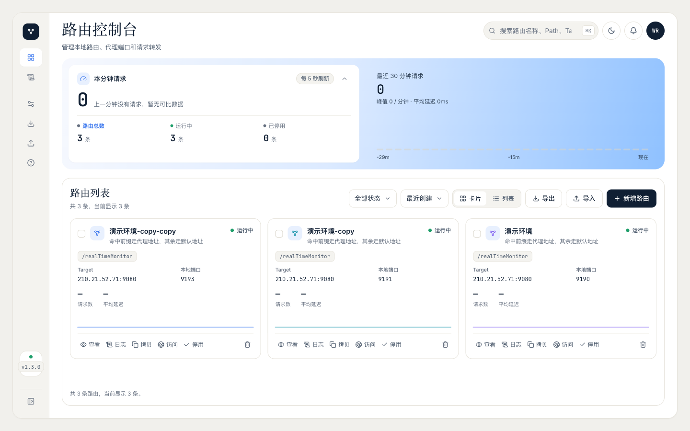
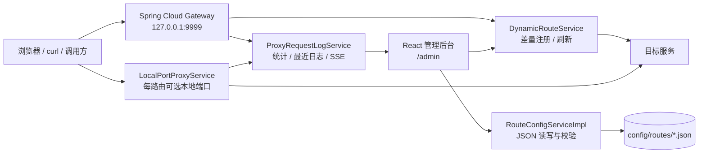

<div align="center">


# wrouter

**把散落在各处的后端服务，收拢成一个地址。**

本地 Web 路由代理 · 路径前缀转发 · 独立本地端口 · 改完即生效

[](https://github.com/geek-xin/web-router/releases/latest)
[](https://github.com/geek-xin/web-router/actions)
[](https://github.com/geek-xin/web-router/releases)
[](https://openjdk.org/projects/jdk/21/)
[](https://spring.io/projects/spring-boot)
[](https://react.dev/)
[](./LICENSE)

[为什么](#为什么需要-wrouter) · [特性](#特性) · [快速开始](#快速开始) · [工作原理](#工作原理) · [配置](#配置) · [常见问题](#常见问题) · [文档](#文档) · [Wiki](https://github.com/geek-xin/web-router/wiki) · [更新日志](./CHANGELOG.md)



<sub>卡片式路由列表 · 30 分钟流量曲线 · 深浅主题一键切换（<a href="docs/assets/wrouter-console-dark.png">深色截图</a>）</sub>

</div>

---

## 为什么需要 wrouter

一个稍大的项目，开发机上的入口通常是这样的：

```text
业务前端      localhost:8081
管理后台      localhost:8082
用户服务      10.0.0.12:9000
文件服务      10.0.0.13:8080
测试环境      192.168.1.50:8080
```

于是你开始记端口、改 `hosts`、改前端 `proxy` 配置、写 `nginx` 片段，每换一个环境就重来一遍。**wrouter 把这件事变成一张表格**：

```text
浏览器 ──▶ wrouter :9999 ──┬── /api/users   →  http://10.0.0.12:9000
                          ├── /portal      →  http://localhost:8082
                          ├── /files       →  http://10.0.0.13:8080
                          └── /            →  http://localhost:8081
```

规则存在本地 JSON 文件里，在浏览器里改完即时生效——**不重启、不写配置、不需要数据库**。

它面向的是「本机 / 内网联调」这个场景：轻、可改、看得见流量。生产级的反向代理、负载均衡、TLS 终止请交给 nginx / Traefik / Envoy。

## 特性

- **多路径前缀** —— 一条路由挂多个前缀（`/test`、`/api/test`），按层级自动 `StripPrefix`
- **独立本地端口** —— 需要固定地址给第三方系统对接时，给路由配 `localIp:localPort`，保留原始 URI
- **改完即生效** —— 增删改查 / 导入后差量刷新，不重建未变化的 routeId，不中断在途请求
- **看得见流量** —— 最近 60 秒请求与失败数、平均延迟、30 分钟曲线、SSE 实时日志、慢请求 Top
- **卡片式控制台** —— 路由卡片、拓扑详情、日志视图、深浅主题、卡片 / 列表切换
- **零外部依赖** —— 单进程 + 本地 JSON，无数据库、无消息队列、无外部缓存
- **开箱即用的交付** —— Windows `exe`、macOS `dmg`、Linux `deb`/`rpm`，以及免安装程序与传统 JAR
- **无感自动更新** —— 静默检查 → 预下载 → 仅在无在途请求时退出重启，失败自动回滚

## 快速开始

### 方式一：下载安装（无需 JDK）

| 平台 | 安装包 | 免安装 |
| --- | --- | --- |
| macOS · Apple Silicon | `wrouter-<version>-macos-arm64.dmg` | `…-macos-arm64-app.zip` |
| macOS · Intel | `wrouter-<version>-macos-x64.dmg` | `…-macos-x64-app.zip` |
| Windows · x64 | `wrouter-<version>-windows-x64.exe` | `…-windows-x64-app.zip` |
| Linux · x64 | `wrouter-<version>-linux-x64.deb` / `.rpm` | `…-linux-x64-app.tar.gz` |
| 任意平台（需 JDK 21） | — | `wrouter-<version>-jar.zip` |

到 [Releases](https://github.com/geek-xin/web-router/releases/latest) 下载，校验后安装：

```bash
shasum -a 256 -c SHA256SUMS.txt
```

> macOS 首次打开若提示「无法验证开发者」：右键 →「打开」，或在「系统设置 → 隐私与安全性」允许。
> Windows SmartScreen 提示时选择「更多信息 → 仍要运行」。详见 [打包与发布](./docs/PACKAGING.md)。

### 方式二：从源码运行

```bash
git clone https://github.com/geek-xin/web-router.git
cd web-router
mvn spring-boot:run      # 默认 http://127.0.0.1:9999，需要 JDK 21
```

打开 <http://localhost:9999/admin>，点击「新增路由」即可。
免安装程序与传统 JAR 的启动方式见 [快速开始 Wiki](https://github.com/geek-xin/web-router/wiki/Getting-Started)。

### 你的第一条路由

后台填表，或者直接调 API：

```bash
curl -X POST http://localhost:9999/admin/api/routes \
  -H 'Content-Type: application/json' \
  -d '{
    "name": "用户服务",
    "pathPrefixes": ["/api/users"],
    "targetUrl": "localhost:8081",
    "localIp": "127.0.0.1",
    "localPort": 18081,
    "enabled": true
  }'
```

`targetUrl` 可以省略协议，保存时会补成 `http://`。保存成功的那一刻，转发就生效了：

```bash
curl http://localhost:9999/api/users/42
# → http://localhost:8081/42    （/api/users 是两段前缀，Gateway 按层级剥掉 2 段）
```

## 工作原理

每个路由有**两条可选的入口**，语义不同——这是使用 wrouter 时最需要理解的一点：

| | Gateway（主端口 `:9999`） | 本地端口代理（`:localPort`） |
| --- | --- | --- |
| 匹配 | 按 `pathPrefixes` 注册 Path 谓词 | 该端口只属于一条路由，全部请求都进 |
| 前缀 | **剥离**（`/test/hello` → `/hello`） | **保留**（`/test/hello` → `/test/hello`） |
| 上游 | `targetUrl` | 命中前缀 → `accessPageBaseUrl`；否则 `targetUrl` |
| 适用 | 统一入口、前端联调 | 第三方系统要求固定地址、老系统不能改 base path |

架构上就是一个 Spring Boot 进程：



## 配置

一条路由一个文件：`config/routes/<id>.json`，可读、可手改、可进版本库。

```json
{
  "id": "route-20261018203000-a1b2c3",
  "name": "用户服务",
  "pathPrefixes": ["/api/users", "/api/v2/users"],
  "targetUrl": "http://localhost:8081",
  "accessPageBaseUrl": "http://localhost:8082",
  "accessPage": "/users",
  "localIp": "127.0.0.1",
  "localPort": 18081,
  "enabled": true
}
```

| 字段 | 必填 | 说明 |
| --- | --- | --- |
| `name` | ✅ | 展示名称，全局唯一 |
| `pathPrefixes` | — | 路径前缀列表，每项以 `/` 开头；同路由内不可重复 |
| `targetUrl` | ✅ | 默认地址（兜底），可省略协议 |
| `accessPageBaseUrl` | 配前缀时必填 | 本地端口**命中前缀**时使用的代理地址 |
| `accessPage` | — | 后台「访问」按钮打开的页面 |
| `localIp` / `localPort` | `localPort` 必填 | 本地独立监听地址，默认 `127.0.0.1` |
| `enabled` | — | 停用后保留配置，但不注册路由、不监听端口 |

应用级配置在 [`application.yml`](./src/main/resources/application.yml)（端口、Gateway 超时、自动更新开关）。
字段语义、校验规则与观测口径的权威说明见 [核心功能说明](./docs/CORE-FEATURES.md)。

## 常见问题

<details>
<summary>改完配置没生效？</summary>

先确认路由 `enabled=true`、`pathPrefixes` 以 `/` 开头、`targetUrl` 可达。
如果接口返回 HTTP 200 但 `success=false`，那是**业务错误**——这是本项目的约定，`message` 里写了原因。
</details>

<details>
<summary>Gateway 和本地端口转发的路径为什么不一样？</summary>

这是设计如此：Gateway 按层级剥离前缀，本地端口代理保留原始 URI（详见[工作原理](#工作原理)）。
需要上游收到完整路径时，用本地端口代理；需要统一入口时，用 Gateway。
</details>

<details>
<summary>统计数字为什么比预期多一倍？</summary>

同时配置了 `localPort` 的路由，一次客户端请求可能产生两条日志：Gateway 一条、本地代理一条。
完整口径见 [核心功能说明](./docs/CORE-FEATURES.md)。
</details>

<details>
<summary>更新日志 / 检查更新报 GitHub 限流？</summary>

未认证的 GitHub API 每小时 60 次。设置环境变量 `WROUTER_GITHUB_TOKEN` 可提升到 5000 次/小时。
</details>

更多排查路径见 [常见问题 Wiki](https://github.com/geek-xin/web-router/wiki/Troubleshooting)。

## 文档

| 文档 | 内容 |
| --- | --- |
| [核心功能说明](./docs/CORE-FEATURES.md) | 数据模型、动态转发、本地端口代理、观测口径、API、校验规则、关键不变量、已知边界 |
| [使用说明](./USAGE.md) | 启动、配置、API、打包与排障的完整操作路径 |
| [打包与发布](./docs/PACKAGING.md) | 交付形态、资产命名契约、自动更新流程、CI 发布 |
| [UI 设计系统](./docs/UI-DESIGN-SYSTEM.md) | 令牌、排版、布局、组件、动效、拓扑与验收清单 |
| [UI 实现映射](./docs/UI-IMPLEMENTATION.md) | 设计规范到文件、类名与数据契约的映射 |
| [Wiki](https://github.com/geek-xin/web-router/wiki) | 快速开始、用户指南、架构、API 参考、排障、开发指南 |
| [变更说明](./CHANGELOG.md) | 每个版本的能力与行为变化 |

## 技术栈

| 层 | 技术 |
| --- | --- |
| 运行框架 | Spring Boot 3.5 / WebFlux（Reactor Netty） |
| 路由代理 | Spring Cloud Gateway |
| 配置存储 | 本地 JSON 文件（无数据库） |
| 管理后台 | React 19 + Vite + Tailwind CSS |
| 页面挂载 | Thymeleaf |
| 打包 | Maven + jpackage（app-image / installer） |
| 测试 | JUnit 5 + AssertJ + Mockito / Vitest |

## 开发

```bash
mvn test                                                  # 198 个后端测试
cd frontend && npm ci && npm run typecheck && npm test    # 74 个前端单测
cd frontend && npm run build                              # 产物写入 src/main/resources/static/admin/
```

打包：

```bash
scripts/build-dist.sh --skip-tests                        # 传统 JAR 分发包
scripts/build-package.sh --type app-image --skip-tests    # 免安装程序（当前平台）
scripts/build-package.sh --type installer --skip-tests    # 安装包 dmg / deb+rpm / exe
scripts/build-release.sh --only jar,app-image,installer   # 全量契约资产 + SHA256SUMS.txt
```

> jpackage 不支持交叉构建：一个平台必须在对应机器（或 CI 矩阵）上打包。
> 改管理后台 UI 前请先读 [UI 设计系统](./docs/UI-DESIGN-SYSTEM.md)——`AdminUiContractTest` 会把规范中的关键契约当作断言校验。

## 贡献

欢迎 issue 与 PR。开始之前：

1. Fork 并切出分支：`git checkout -b feat/your-feature`
2. 按 [AGENTS.md](./AGENTS.md) 的修改约定同步文档与测试（改 UI 要同步设计系统文档，改核心机制要同步核心功能文档）
3. 确保 `mvn test` 与 `npm run build` 通过
4. 提交 PR，说明变更动机、影响范围与验证方式

## 许可证

[MIT](./LICENSE) © geek-xin
