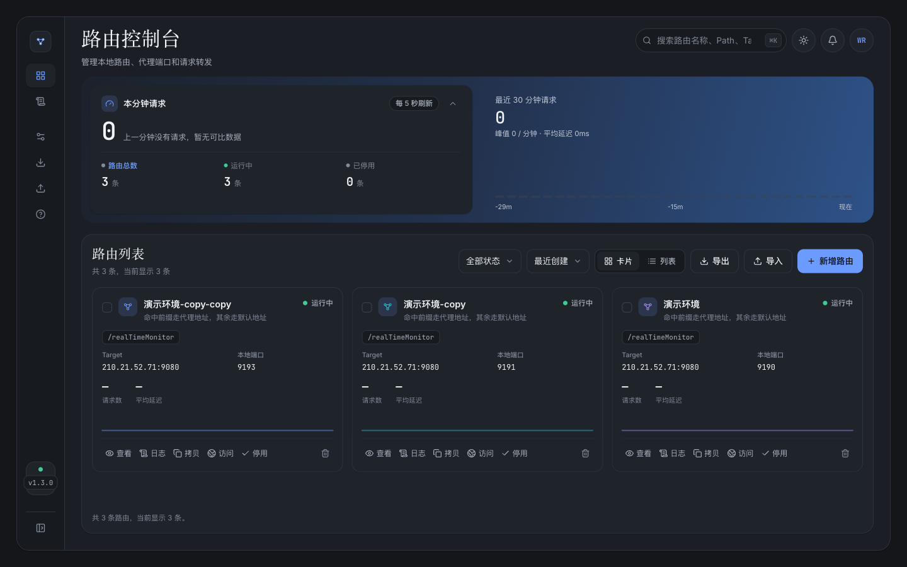
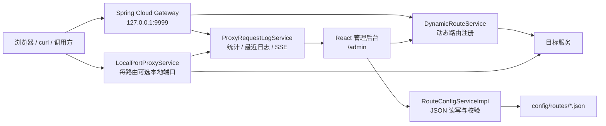

<div align="center">


# wrouter

**本地 Web 路由代理 —— 路径前缀转发、独立本地端口、改完即生效**

[](https://github.com/geek-xin/web-router/releases)
[](https://github.com/geek-xin/web-router/actions)
[](https://openjdk.org/projects/jdk/21/)
[](https://spring.io/projects/spring-boot)
[](https://react.dev/)
[](./LICENSE)

[快速开始](#快速开始) · [下载](#下载与安装) · [功能](#功能) · [文档](#文档) · [Wiki](https://github.com/geek-xin/web-router/wiki) · [更新日志](./CHANGELOG.md)

</div>

---

## wrouter 是什么

开发、联调、测试环境里，后端服务经常散落在不同的主机和端口：`localhost:8081` 的业务、`10.0.0.12:9000` 的网关、另一台机器上的门户。**wrouter 用一份本地 JSON 把这些入口收拢成一个地址**：

```text
浏览器 ──▶ wrouter :9999 ──▶ /api/users  → http://localhost:8081
                          ├─ /portal     → http://10.0.0.12:9000
                          └─ /static     → http://localhost:8082
```

- **不需要数据库**：一条路由一个文件，`config/routes/<id>.json`，可读、可手改、可进版本库。
- **不需要重启**：在后台增删改查后，Gateway 路由与本地端口代理立即刷新。
- **每个路由可独立监听**：需要固定端口给第三方系统对接时，给路由配 `localIp:localPort` 即可。
- **看得见流量**：请求数、失败数、平均延迟、最近 30 分钟曲线、SSE 实时日志。

## 功能

| | 能力 | 说明 |
| --- | --- | --- |
| 🔀 | **多路径前缀转发** | 一条路由可挂多个前缀（`/test`、`/api/test`），按层级自动 `StripPrefix` |
| 🔌 | **独立本地端口** | 单条路由可选监听 `127.0.0.1:18081`，保留原始 URI，不剥离前缀 |
| ♻️ | **动态生效** | 创建 / 更新 / 删除 / 导入后差量刷新，不重启、不中断在途请求 |
| 📊 | **流量指标** | 最近 60 秒请求数、失败数、累计平均延迟、最近 30 分钟每分钟序列 |
| 📡 | **实时日志** | 快照 + SSE 推送，按路由筛选，含慢请求 Top 与诊断 |
| 🎛️ | **卡片式控制台** | 路由卡片、拓扑图、详情视图、深浅主题、列表/卡片切换 |
| 🔔 | **更新日志** | 顶栏铃铛直接展示最新版本的修订内容，未读有新版本才亮红点 |
| 📦 | **多平台交付** | Windows `exe`、macOS `dmg`、Linux `deb`/`rpm`，以及免安装 app-image 与传统 JAR |
| ⬆️ | **无感自动更新** | 静默检查 → 预下载 → 仅在无在途请求时退出重启，失败自动回滚 |

## 截图

| 浅色 | 深色 |
| --- | --- |
|  |  |

## 下载与安装

从 [Releases](https://github.com/geek-xin/web-router/releases/latest) 下载对应平台产物：

| 平台 | 安装包 | 免安装 |
| --- | --- | --- |
| macOS (Apple Silicon) | `wrouter-<version>-macos-arm64.dmg` | `wrouter-<version>-macos-arm64-app.zip` |
| macOS (Intel) | `wrouter-<version>-macos-x64.dmg` | `wrouter-<version>-macos-x64-app.zip` |
| Windows x64 | `wrouter-<version>-windows-x64.exe` | `wrouter-<version>-windows-x64-app.zip` |
| Linux x64 | `wrouter-<version>-linux-x64.deb` / `.rpm` | `wrouter-<version>-linux-x64-app.tar.gz` |
| 任意（需 JDK 21） | — | `wrouter-<version>-jar.zip` |

校验下载内容：

```bash
shasum -a 256 -c SHA256SUMS.txt
```

> 安装包与免安装程序都内置运行时，**不需要预装 JDK**。macOS / Windows 未签名应用的首次打开提示见 [打包与发布](./docs/PACKAGING.md)。

安装完成后打开 <http://localhost:9999/admin>。

## 快速开始

### 从源码运行

```bash
git clone https://github.com/geek-xin/web-router.git
cd web-router

mvn test                # 198 个后端测试（含 UI 契约测试）
mvn spring-boot:run     # 默认监听 127.0.0.1:9999
```

前端源码在 `frontend/`，产物已提交到 `src/main/resources/static/admin/`；只有改前端时才需要：

```bash
cd frontend && npm ci && npm run build
```

### 第一条路由

打开 <http://localhost:9999/admin> → 新增路由，或直接调 API：

```bash
curl -X POST http://localhost:9999/admin/api/routes \
  -H 'Content-Type: application/json' \
  -d '{
    "name": "测试服务",
    "pathPrefixes": ["/test", "/api/test"],
    "targetUrl": "localhost:8081",
    "accessPageBaseUrl": "localhost:8082",
    "accessPage": "/test/hello",
    "localIp": "127.0.0.1",
    "localPort": 18081,
    "enabled": true
  }'
```

保存后立即生效：

| 请求 | 上游收到 | 为什么 |
| --- | --- | --- |
| `http://localhost:9999/test/hello` | `http://localhost:8081/hello` | Gateway 按层级剥离前缀 |
| `http://127.0.0.1:18081/test/hello` | `http://localhost:8082/test/hello` | 本地端口命中前缀 → 代理地址，保留 URI |
| `http://127.0.0.1:18081/other` | `http://localhost:8081/other` | 本地端口未命中前缀 → 默认地址 |

> **两条入口语义不同**：Gateway 剥离前缀，本地端口代理保留原始 URI。完整对照见 [核心功能说明](./docs/CORE-FEATURES.md)。

## 架构



| 层 | 技术 |
| --- | --- |
| 运行框架 | Spring Boot 3.5 / WebFlux（Reactor Netty） |
| 路由代理 | Spring Cloud Gateway |
| 配置存储 | 本地 JSON 文件（无数据库） |
| 管理后台 | React 19 + Vite + Tailwind CSS |
| 页面挂载 | Thymeleaf |
| 打包 | Maven + jpackage（app-image / installer） |

## 配置

路由字段、校验规则与转发语义的权威说明见 [docs/CORE-FEATURES.md](./docs/CORE-FEATURES.md)。常用字段速查：

| 字段 | 必填 | 说明 |
| --- | --- | --- |
| `name` | ✅ | 展示名称，全局唯一 |
| `pathPrefixes` | — | 路径前缀列表，每项以 `/` 开头 |
| `targetUrl` | ✅ | 默认地址（兜底），可省略协议 |
| `accessPageBaseUrl` | 配前缀时必填 | 本地端口命中前缀时使用的代理地址 |
| `accessPage` | — | 后台「访问」按钮打开的页面 |
| `localIp` / `localPort` | `localPort` 必填 | 本地独立监听地址 |
| `enabled` | — | 停用后保留配置但不注册路由 |

应用级配置在 `src/main/resources/application.yml`（端口、Gateway、Thymeleaf、Actuator），自动更新开关在 `wrouter.update.*`。

## 文档

| 文档 | 内容 |
| --- | --- |
| [核心功能说明](./docs/CORE-FEATURES.md) | 数据模型、动态转发、本地端口代理、观测口径、API、校验规则、关键不变量、已知边界 |
| [使用说明](./USAGE.md) | 启动、配置、API、打包与排障的完整操作路径 |
| [打包与发布](./docs/PACKAGING.md) | 交付形态、资产命名契约、自动更新流程、CI 发布 |
| [UI 设计系统](./docs/UI-DESIGN-SYSTEM.md) | 令牌、排版、布局、组件、动效、拓扑与验收清单 |
| [UI 实现映射](./docs/UI-IMPLEMENTATION.md) | 设计规范到文件、类名与数据契约的映射 |
| [Wiki](https://github.com/geek-xin/web-router/wiki) | 更短的上手指南、架构速查与常见问题 |
| [变更说明](./CHANGELOG.md) | 每个版本的能力与行为变化 |

## 开发

```bash
mvn test                                              # 后端测试
cd frontend && npm run typecheck && npm test && npm run build
```

打包：

```bash
scripts/build-dist.sh --skip-tests                        # 传统 JAR 分发包
scripts/build-package.sh --type app-image --skip-tests    # 免安装程序（当前平台）
scripts/build-package.sh --type installer --skip-tests    # 安装包 dmg / deb+rpm / exe
scripts/build-release.sh --only jar,app-image,installer   # 全量契约资产 + SHA256SUMS.txt
```

jpackage 不支持交叉构建，一个平台必须在对应机器（或 CI 矩阵）上构建。

> 改管理后台 UI 前请先读 [UI 设计系统](./docs/UI-DESIGN-SYSTEM.md)：`AdminUiContractTest` 会把规范中的关键契约当作断言校验。

## 贡献

1. Fork 并切出分支：`git checkout -b feat/your-feature`
2. 按 [AGENTS.md](./AGENTS.md) 的修改约定同步文档与测试
3. 确保 `mvn test` 与 `npm run build` 通过
4. 提交 PR，描述变更动机与验证方式

## 许可证

[MIT](./LICENSE) © geek-xin
