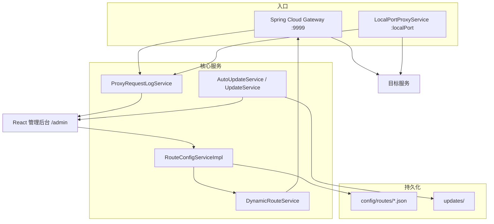
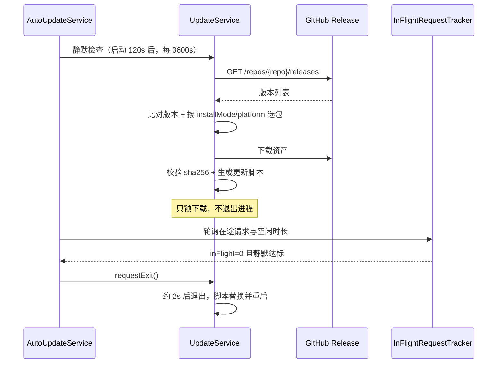

# 架构与机制

## 运行时组成

| 组件 | 实现 | 职责 |
| --- | --- | --- |
| 主网关 | Spring Cloud Gateway（Reactor Netty） | 按 Path 谓词转发主端口流量 |
| 本地端口代理 | Reactor Netty `HttpServer` + `HttpClient` | 为单条路由提供独立入口 |
| 配置存储 | 本地 JSON 文件 | 唯一持久化介质，无数据库 |
| 请求观测 | 内存统计 + SSE | 快照日志、实时流、滚动流量指标 |
| 管理后台 | React 19 + Vite + Tailwind | 路由增删改查、拓扑、日志、指标、版本更新 |
| 页面挂载 | Thymeleaf | 输出 `#root`，注入配置目录 meta 与资源版本串 |

## 配置存储

- 一条路由 = 一个文件：`config/routes/<id>.json`，位于应用根目录下。
- 应用根目录解析顺序：系统属性 `wrouter.home` → 环境变量 `WROUTER_HOME` → `user.dir`（启动工作目录）。
- 写入使用 Jackson pretty printer，文件可读、可手工编辑、可进版本库。
- `listAll()` 按文件最后修改时间倒序返回。
- **配置文件名 = 路由 ID**；任何外部传入的 routeId 都必须经 `resolveFilePath()` 校验（`^[a-zA-Z0-9_-]+$`），用于阻断路径穿越。
- 写操作在 `synchronized (fileMonitor)` 内串行；更新时若可编辑内容未变，会恢复原 mtime，避免列表顺序跳动。

运行时目录：

| 路径 | 说明 |
| --- | --- |
| `config/routes/` | 路由配置文件目录 |
| `updates/` | 自动更新工作目录（更新包、脚本、`backup-<版本>/`、`update.log`） |
| `logs/` | 应用日志输出目录 |

## Gateway 动态转发

`DynamicRouteService.refreshAll()` 的流程：

1. 取信号量，保证同一时刻只有一次刷新。
2. 计算期望路由集：所有 `enabled` 配置 × 每个路径前缀 = 一条 Gateway 路由。
3. 差量计算需删除与需保存的 routeId，顺序执行（内容未变的 routeId 不删除重建，避免刷新瞬间 404）。
4. 刷新本地端口代理，替换内存快照并发布 `RefreshRoutesEvent`。

所有写操作（创建 / 更新 / 删除 / 导入）持久化后都会触发刷新，**改完即生效**。

注册规则：

| 项 | 规则 |
| --- | --- |
| routeId | 第 1 个前缀用基础 `id`，后续用 `<id>__<n>`，如 `route-xxx__1` |
| Path 谓词 | `/` → `/**`；`/test` → `/test,/test/**` |
| StripPrefix | 按前缀层级剥离：`/test` 剥 1 段，`/test/api` 剥 2 段，`/` 不剥离 |
| order | 固定 0 |

`pathPrefixes` 为空时不注册任何 Gateway 路由，该路由只能通过本地端口代理访问。

## 本地端口代理

启动条件：路由 `enabled=true` 且 `localPort` 非空，绑定 `effectiveLocalIp():localPort`。

| 时机 | 行为 |
| --- | --- |
| 配置变化但绑定不变 | 原地更新配置引用，不重启监听，避免连接中断 |
| 绑定新增 | 启动新监听 |
| 绑定消失 / 停用 / 删除 | 停止并释放监听 |
| 应用关闭 | `@PreDestroy` 逐个释放 |

转发行为：透传方法与请求体，过滤 hop-by-hop 头（`connection`、`keep-alive`、`transfer-encoding`、`upgrade`、`te`、`trailer`、`proxy-*` 及 `Connection` 中列出的自定义头），把 `Host` 改写为目标地址。

响应强制 `Connection: close` 与 `Cache-Control: no-store, no-cache, must-revalidate, max-age=0`，避免增删 `pathPrefixes` 后浏览器复用旧连接或缓存旧结果。上游失败返回 **HTTP 502** + 文本 `Proxy request failed`，并记录一条 502 日志。

## 请求观测链路

| 入口 | 采集者 |
| --- | --- |
| 主端口 Gateway | `ProxyRequestLogFilter`（`GlobalFilter`，`HIGHEST_PRECEDENCE`） |
| 本地端口 | `LocalPortProxyService.proxy()` |

两条路径写入同一个 `ProxyRequestLogService`，统计口径一致。**同时配置 `localPort` 的路由，一次客户端请求可能产生两条日志**（Gateway 一条 + 本地代理一条）。

指标窗口：最近 60 秒请求/失败数用 1 秒桶 × 60，30 分钟序列用 60 秒桶 × 30，累计平均延迟来自累计耗时。

## 版本与自动更新

- 构建元信息由 `pom.xml` 资源过滤注入 `version.properties`（版本 / 构建时间 / 平台 / 安装形态 / 通道 / 仓库）。
- `/admin/api/update/check` 约定「任何异常都写进 message，接口本身始终成功」。
- 更新脚本写在 `updates/apply-update.sh|.bat`：等旧进程退出 → 备份 → 解压替换 → 重启，失败自动回滚并写 `updates/update.log`。

## 管理后台资源

| 文件 | 职责 |
| --- | --- |
| `frontend/src/App.tsx` | 应用外壳：侧边栏、顶栏、概览带、路由网格 |
| `frontend/src/features/**` | 路由卡片、工具栏、表单、详情、拓扑、日志、指标、版本与更新日志 |
| `frontend/src/styles.css` | CSS 变量与组件层样式入口 |
| `src/main/resources/templates/index.html` | Thymeleaf 挂载页 |
| `src/main/resources/static/admin/assets/app.js`、`app.css` | Vite 构建产物 |

入口页不缓存（`no-store`），静态资源版本串由 `AssetVersionResolver` 按产物内容哈希生成，
因此「改了但看不到」不会发生。改前端后需 `npm run build` 更新静态资源。

> 完整实现细节、关键不变量与已知边界见 [核心功能说明](../docs/CORE-FEATURES.md)。
