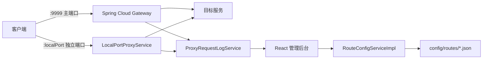

# wrouter Wiki

**本地 Web 路由代理 —— 路径前缀转发、独立本地端口、改完即生效**

[仓库主页](https://github.com/geek-xin/web-router) · [下载](https://github.com/geek-xin/web-router/releases/latest) · [更新日志](https://github.com/geek-xin/web-router/blob/main/CHANGELOG.md)

---

`wrouter` 把「路径前缀 → 后端服务」的转发规则存成本地 JSON 文件，改完立即生效、无需重启。
开发、联调、测试环境里那些散落在不同主机和端口的服务入口，被收拢成一个地址。

当前版本：`1.4.0`。Java 包名仍为 `com.geek.webrouter`（历史保留）。

## 它解决什么问题

| 痛点 | wrouter 的做法 |
| --- | --- |
| 多个后端入口分散，切换与记忆成本高 | 一条路由挂多个路径前缀，统一从 `:9999` 进入 |
| 改一条规则就要重启代理 | 写操作后差量刷新 Gateway 路由与本地代理，不中断在途请求 |
| 第三方系统要求固定地址 / 端口 | 单条路由可选监听 `localIp:localPort`，独立入口 |
| 不知道流量打到哪、慢在哪 | 卡片指标、30 分钟曲线、SSE 实时日志、慢请求 Top |
| 分发要用户装 JDK | 安装包与免安装程序内置运行时，另提供传统 JAR |

## 核心能力

| 能力 | 说明 |
| --- | --- |
| 多路径前缀转发 | 一条路由多个 `pathPrefixes`，按层级自动 `StripPrefix` |
| 独立本地端口 | 命中前缀走 `accessPageBaseUrl`，未命中走 `targetUrl`，保留原始 URI |
| 本地 JSON 持久化 | `config/routes/<id>.json`，一条路由一个文件，无数据库 |
| 动态生效 | 创建 / 更新 / 删除 / 导入后差量刷新，不重建未变化的 routeId |
| 请求观测 | 滚动请求数 / 失败数 / 平均延迟 / 30 分钟序列 + 最近 100 条日志 + SSE |
| 卡片式控制台 | 路由卡片、拓扑详情、日志视图、深浅主题、卡片/列表切换 |
| 更新日志铃铛 | 顶栏直接看最新版本改了什么，未读有新版本才亮红点 |
| 多平台交付与自动更新 | `dmg` / `exe` / `deb`+`rpm` / app-image / JAR，空闲时无感升级 |

## 快速入口

| 入口 | 地址 |
| --- | --- |
| 管理后台 | <http://localhost:9999/admin> |
| 健康检查 | <http://localhost:9999/actuator/health> |
| 应用信息 | <http://localhost:9999/actuator/info> |

默认监听 `127.0.0.1:9999`，配置见 `src/main/resources/application.yml`。

## 架构一览

## 三种交付形态

| 形态 | 说明 |
| --- | --- |
| 安装包 | macOS `dmg` / Windows `exe` / Linux `deb`、`rpm` |
| 免安装 app-image | 解压即用，内置运行时（`-app.zip` / Linux `-app.tar.gz`） |
| 传统 JAR | `java -jar wrouter-<version>.jar`，需自带 JDK 21 |

三种形态都支持管理后台的**自动更新**，并在版本抽屉与侧边栏展示当前版本号。
构建命令、产物命名与目录结构详见 [打包与发布](../docs/PACKAGING.md)。

## 阅读顺序

1. [快速开始](Getting-Started) —— 五分钟跑起来并验证转发
2. [用户指南](User-Guide) —— 路由字段、校验规则、两条入口的语义差异
3. [架构与机制](Architecture) —— 动态路由、本地端口代理、观测链路
4. [API 参考](API-Reference) —— 全部管理接口与错误码
5. [常见问题](Troubleshooting) —— 访问不到、统计对不上、端口冲突
6. [开发指南](Development-Guide) —— 关键文件、修改约定、验证命令

## 权威文档

wiki 只做速查，细节以仓库文档为准：

- [核心功能说明](../docs/CORE-FEATURES.md)：数据模型、转发语义、观测口径、校验规则、关键不变量、已知边界。
- [UI 设计系统](../docs/UI-DESIGN-SYSTEM.md)：管理后台视觉与交互规范。
- [UI 实现映射](../docs/UI-IMPLEMENTATION.md)：规范到文件与数据契约的映射。
- [打包与发布](../docs/PACKAGING.md)：交付形态、构建、自动更新与 CI 发布。
- [使用说明](../USAGE.md)：完整操作路径与 curl 示例。
