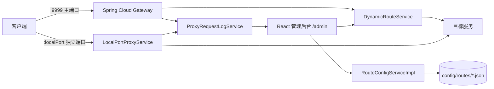

<div align="center">


# wrouter Wiki

**把散落在各处的后端服务，收拢成一个地址。**

本地 Web 路由代理 · 路径前缀转发 · 独立本地端口 · 改完即生效

[](https://github.com/geek-xin/web-router/releases/latest)
[](https://openjdk.org/projects/jdk/21/)
[](https://github.com/geek-xin/web-router/blob/main/LICENSE)

[仓库主页](https://github.com/geek-xin/web-router) · [下载](https://github.com/geek-xin/web-router/releases/latest) · [更新日志](https://github.com/geek-xin/web-router/blob/main/CHANGELOG.md)

</div>

---

## wrouter 是什么

一个跑在本机的单进程 Web 路由代理。它把「路径前缀 → 后端服务」的转发规则存在本地 JSON 文件里，
在浏览器里改完即时生效——不重启、不写 nginx 配置、不需要数据库。

```text
浏览器 ──▶ wrouter :9999 ──┬── /api/users   →  http://10.0.0.12:9000
                          ├── /portal      →  http://localhost:8082
                          ├── /files       →  http://10.0.0.13:8080
                          └── /            →  http://localhost:8081
```

它面向「本机 / 内网联调」这个场景：轻、可改、看得见流量。
生产级的反向代理、负载均衡、TLS 终止请交给 nginx / Traefik / Envoy。

当前版本 `1.4.0`；Java 包名仍为 `com.geek.webrouter`（历史保留）。

## 它解决什么问题

| 常见痛点 | wrouter 的做法 |
| --- | --- |
| 后端入口分散在不同主机端口，记不住也切不过来 | 一条路由挂多个路径前缀，统一从 `:9999` 进入 |
| 改一条规则就要重启代理或改 nginx | 写操作后差量刷新 Gateway 路由与本地代理，不中断在途请求 |
| 第三方系统要求固定地址 / 端口，还不能改 base path | 单条路由可选监听 `localIp:localPort`，保留原始 URI |
| 不知道流量打到哪、慢在哪 | 卡片指标、30 分钟曲线、SSE 实时日志、慢请求 Top |
| 分发给同事要对方先装 JDK | 安装包与免安装程序内置运行时，另提供传统 JAR |

## 快速入口

| 入口 | 地址 | 说明 |
| --- | --- | --- |
| 管理后台 | <http://localhost:9999/admin> | 路由增删改查、拓扑、日志、指标、版本与更新 |
| 健康检查 | <http://localhost:9999/actuator/health> | 返回 `{"status":"UP"}` |
| 应用信息 | <http://localhost:9999/actuator/info> | Actuator 元信息 |

默认监听 `127.0.0.1:9999`，见 `src/main/resources/application.yml`。

## 核心概念

理解三个词就能用起来：

| 概念 | 含义 |
| --- | --- |
| **路由（Route）** | 一组转发规则，保存为 `config/routes/<id>.json`，一条路由一个文件 |
| **路径前缀（pathPrefixes）** | 该路由认领的路径，如 `/api/users`；可挂多个，不同路由可复用 |
| **本地端口（localPort）** | 可选。给该路由一个独立监听地址，让第三方系统按固定地址访问 |

每个路由因此有**两条可选的入口**，语义不同：

| | Gateway（主端口 `:9999`） | 本地端口代理（`:localPort`） |
| --- | --- | --- |
| 匹配 | 按 `pathPrefixes` 注册 Path 谓词 | 该端口只属于这条路由，全部请求都进 |
| 前缀 | **剥离**（`/test/hello` → `/hello`） | **保留**（`/test/hello` → `/test/hello`） |
| 上游 | `targetUrl` | 命中前缀 → `accessPageBaseUrl`；否则 `targetUrl` |
| 适用 | 统一入口、前端联调 | 第三方对接、老系统不能改 base path |

> 这是使用 wrouter 时最需要记住的一点。细节见 [用户指南](User-Guide) 与
> [核心功能说明](https://github.com/geek-xin/web-router/blob/main/docs/CORE-FEATURES.md)。

## 架构一览



单进程、无数据库：配置是文件，统计在内存，页面由同一个进程提供。

## 三种交付形态

| 形态 | 产物 | 是否需要 JDK | 升级方式 |
| --- | --- | --- | --- |
| 安装包 | macOS `dmg` / Windows `exe` / Linux `deb`、`rpm` | 否 | 包管理器或重新安装 |
| 免安装 app-image | `-app.zip` / Linux `-app.tar.gz` | 否 | 自动更新或手动替换目录 |
| 传统 JAR | `wrouter-<version>-jar.zip` | 是（21） | 自动更新或手动替换 jar |

三种形态都支持管理后台的**无感自动更新**，并在侧边栏运行卡与版本抽屉展示当前版本。
构建命令、资产命名与目录结构详见
[打包与发布](https://github.com/geek-xin/web-router/blob/main/docs/PACKAGING.md)。

## 从这里开始

| 你在做什么 | 看哪一页 |
| --- | --- |
| 第一次安装、跑通第一条路由 | [快速开始](Getting-Started) |
| 日常使用后台、查字段含义与校验规则 | [用户指南](User-Guide) |
| 想弄清动态路由 / 本地端口代理 / 观测链路 | [架构与机制](Architecture) |
| 写脚本或对接管理接口 | [API 参考](API-Reference) |
| 访问不到、统计对不上、端口冲突 | [常见问题](Troubleshooting) |
| 参与开发、改代码、发版本 | [开发指南](Development-Guide) |

## 仓库文档（权威）

wiki 只做速查与导览，细节以仓库文档为准：

- [核心功能说明](https://github.com/geek-xin/web-router/blob/main/docs/CORE-FEATURES.md)：数据模型、转发语义、观测口径、校验规则、关键不变量、已知边界
- [UI 设计系统](https://github.com/geek-xin/web-router/blob/main/docs/UI-DESIGN-SYSTEM.md)：管理后台视觉与交互规范
- [UI 实现映射](https://github.com/geek-xin/web-router/blob/main/docs/UI-IMPLEMENTATION.md)：规范到文件、类名与数据契约
- [打包与发布](https://github.com/geek-xin/web-router/blob/main/docs/PACKAGING.md)：交付形态、构建、自动更新与 CI
- [使用说明](https://github.com/geek-xin/web-router/blob/main/USAGE.md)：完整操作路径与 curl 示例
- [更新日志](https://github.com/geek-xin/web-router/blob/main/CHANGELOG.md)：每个版本的能力与行为变化
